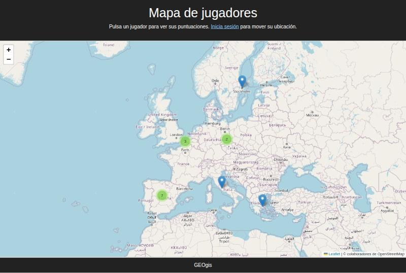
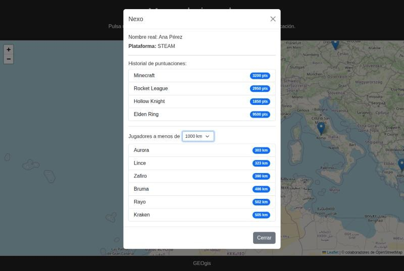
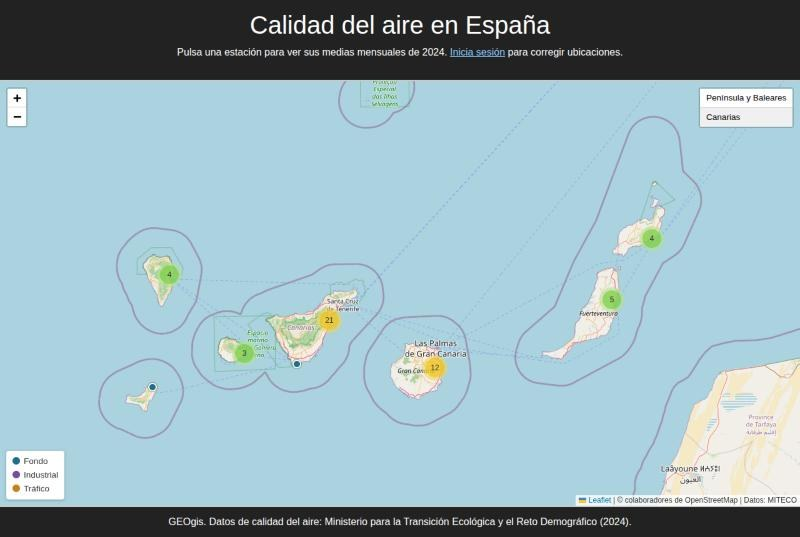

# GEOgis

[](https://github.com/EnderFairXD/GEOgis-SimpleWeb/actions/workflows/tests.yml)

Mapa de la **red oficial de estaciones de calidad del aire de España**, hecho con **GeoDjango**,
**PostGIS** y **Leaflet**. Importa las 612 estaciones y las medias mensuales de contaminantes
publicadas por el Ministerio para la Transición Ecológica (MITECO), y permite consultarlas en el
mapa: datos de cada estación, sus coordenadas en el sistema UTM oficial que le corresponde y las
estaciones que tiene alrededor.



## Qué hace

- **Mapa** con las estaciones activas, coloreadas por tipo (fondo, industrial o tráfico) y
  agrupadas cuando están cerca. Un control salta entre la Península y Baleares y Canarias.
- **Ficha de la estación**: tipo y área, altitud, red, dirección, coordenadas geográficas y UTM,
  y las medias mensuales de 2024 de cada contaminante que mide. Las medias horarias calculadas con
  menos del 75 % de las horas del mes se marcan como poco fiables, y cada mes indica con cuántas
  horas o días se calculó.
- **Estaciones cercanas** a 10, 25, 50 o 100 km, ordenadas por distancia geodésica.
- **Corrección de ubicaciones**: los usuarios con permiso pueden arrastrar una estación en el mapa
  (modo arrastrar de Geoman) o moverla en el admin, y la nueva posición se guarda. El servidor
  rechaza (403) a cualquier otro usuario. Las ubicaciones corregidas se conservan al volver a
  importar los datos del MITECO.
- **Panel de administración** con mapa para editar estaciones y consultar sus mediciones.

| Ficha de una estación | Canarias |
|---|---|
|  |  |

## Sistemas de referencia

Las estaciones se guardan como `geography` en **WGS84 (EPSG:4326)**. Así PostGIS calcula las
distancias **sobre el elipsoide**, con la misma precisión en Galicia, Cataluña o Canarias.
Proyectar toda España en un único huso UTM (por ejemplo EPSG:25830) desvía las distancias un
0,2–0,3 % en los husos vecinos y casi un 2 % en Canarias.

La ficha muestra además las coordenadas en metros en el **sistema UTM oficial de cada zona**:

| Zona | Huso | Sistema |
|---|---|---|
| Galicia y oeste peninsular | 29 | ETRS89 / UTM 29N (EPSG:25829) |
| Centro peninsular, Ceuta y Melilla | 30 | ETRS89 / UTM 30N (EPSG:25830) |
| Cataluña, este peninsular y Baleares | 31 | ETRS89 / UTM 31N (EPSG:25831) |
| Canarias | 28 | REGCAN95 / UTM 28N (EPSG:4083) |

Los tests comprueban las coordenadas UTM contra las publicadas por el Ayuntamiento de Madrid
(menos de 1 m de diferencia) y que las distancias son las del elipsoide y no las de una esfera.

## Datos

| Qué | Fichero del MITECO |
|---|---|
| Estaciones y catálogo de contaminantes | `Metainformacion_2024.xlsx` |
| Medias mensuales | `Datos_HH_2024.zip` (horarios) y `Datos_DD_2024.zip` (diarios) |

Los importadores descargan los ficheros, así que no se guardan en el repositorio. Las medias
mensuales se calculan al importar: un año de datos horarios son unos 28 millones de valores y en
la base de datos quedan unas 48.000 medias. Se usan los datos horarios y, para los meses sin
ellos (metales, benzo(a)pireno, captadores manuales), los diarios. Se descartan los valores
negativos.

Cada media guarda de qué fichero sale y con cuántos datos se calculó. Una media horaria con menos
del 75 % de las horas del mes se considera poco fiable (en 2024, unas 1.400 de 48.000). Las
diarias no se marcan, porque los captadores de metales y benzo(a)pireno muestrean unos pocos días
al mes por diseño.

**Fuente:** Ministerio para la Transición Ecológica y el Reto Demográfico,
[datos oficiales de calidad del aire 2024](https://www.miteco.gob.es/es/calidad-y-evaluacion-ambiental/temas/atmosfera-y-calidad-del-aire/evaluacion-y-datos-de-calidad-del-aire/datos/datos-oficiales-2024.html).
Reutilización según la Ley 37/2007 de reutilización de la información del sector público.

## Arranque rápido con Docker

Solo necesitas Docker. Levanta PostgreSQL + PostGIS y la app y aplica las migraciones:

```bash
docker compose up --build
```

En otra terminal, importa los datos (una sola vez: se guardan en el volumen de la base de datos)
y crea un usuario para el panel de administración:

```bash
docker compose exec web python manage.py importar_estaciones
docker compose exec web python manage.py importar_mediciones
docker compose exec web python manage.py createsuperuser
```

Abre <http://localhost:8000/>.

## Instalación manual

### Requisitos

- Python 3.10+
- PostgreSQL con la extensión **PostGIS**
- Librerías del sistema de GeoDjango: GDAL, GEOS y PROJ
  ([guía oficial](https://docs.djangoproject.com/en/5.2/ref/contrib/gis/install/))

### Puesta en marcha

```bash
python -m venv .venv && source .venv/bin/activate
pip install -r requirements.txt

# Base de datos (una sola vez)
createdb GeoDjango
psql -d GeoDjango -c "CREATE EXTENSION postgis;"

cp .env.example .env     # rellena DB_PASSWORD y DJANGO_SECRET_KEY (se lee automáticamente)

python manage.py migrate
python manage.py importar_estaciones
python manage.py importar_mediciones
python manage.py createsuperuser
python manage.py runserver
```

Abre <http://127.0.0.1:8000/> para el mapa y <http://127.0.0.1:8000/admin/> para el panel.

## API

| Método y ruta | Devuelve |
|---|---|
| `GET /api/estaciones/` | `FeatureCollection` GeoJSON con las estaciones activas (sin mediciones, para que el mapa cargue rápido) |
| `GET /api/estaciones/<id>/` | Ficha: datos, coordenadas WGS84 y UTM, y medias mensuales por contaminante |
| `GET /api/estaciones/<id>/cercanas/?km=25` | Estaciones activas a menos de `km` kilómetros (hasta 1000), de la más cercana a la más lejana |
| `POST /api/estaciones/<id>/ubicacion/` | Guarda `{"lat": …, "lng": …}` (dentro de España) y devuelve las nuevas coordenadas UTM. Requiere el permiso `main.change_estacion` |

## Estructura

| Ruta | Contenido |
|---|---|
| `geogis/` | Configuración del proyecto Django |
| `main/models.py` | `Estacion` (`PointField` geography), `Contaminante` y `MedicionMensual` |
| `main/geo.py` | Huso y coordenadas UTM oficiales de cada punto de España |
| `main/importacion.py` | Lectura de los ficheros del MITECO y cálculo de las medias mensuales |
| `main/management/commands/` | Comandos `importar_estaciones` e `importar_mediciones` |
| `main/views.py` | Vista del mapa y endpoints de la API |
| `main/static/js/Main.js` | Mapa, agrupación, ficha de la estación y corrección de ubicaciones |
| `main/tests/` | Tests de coordenadas, importación, API, permisos y admin |
| `.github/workflows/tests.yml` | CI: tests con PostGIS y arranque completo con Docker Compose |

## Tests

```bash
python manage.py test                                  # instalación manual
docker compose run --rm web python manage.py test      # con Docker
```

Necesitan la misma base de datos PostGIS (Django crea y borra una base de pruebas aparte). No
descargan nada: generan ficheros con el formato del MITECO en una carpeta temporal.

## Licencia

Código: MIT © Javier Cortés Vidal. Datos: MITECO (ver [Datos](#datos)).
