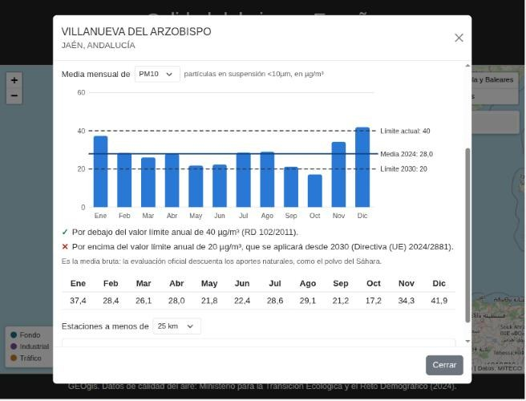
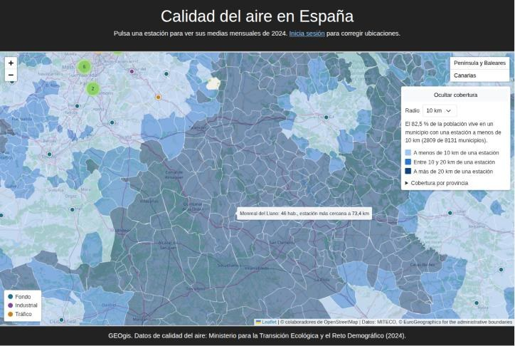
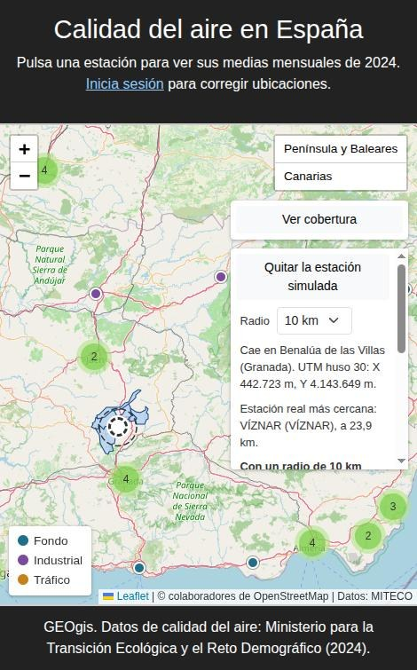
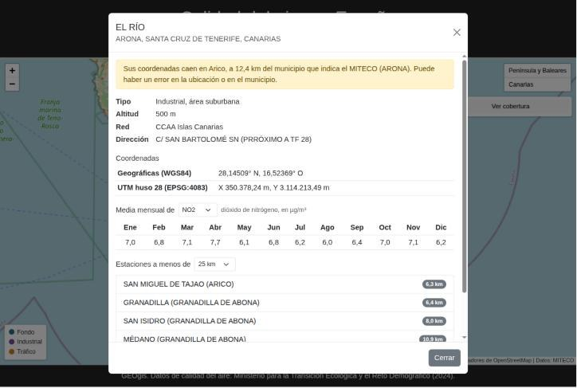

# GEOgis

[](https://github.com/EnderFairXD/GEOgis-SimpleWeb/actions/workflows/tests.yml)

Mapa de la **red oficial de estaciones de calidad del aire de España**, hecho con **GeoDjango**,
**PostGIS** y **Leaflet**. Importa las 612 estaciones y las medias mensuales de contaminantes
publicadas por el Ministerio para la Transición Ecológica (MITECO), y permite consultarlas en el
mapa: datos de cada estación, sus coordenadas en el sistema UTM oficial que le corresponde y las
estaciones que tiene alrededor. Con los 8.131 municipios de España analiza además la
**cobertura** de la red: qué parte de la población tiene una estación cerca.


## Qué hace

- **Mapa** con las estaciones activas, coloreadas por tipo (fondo, industrial o tráfico) y
  agrupadas cuando están cerca. Un control salta entre la Península y Baleares y Canarias.
- **Ficha de la estación**: tipo y área, altitud, red, dirección, coordenadas geográficas y UTM,
  y las medias mensuales de 2024 de cada contaminante que mide. Las medias horarias calculadas con
  menos del 75 % de las horas del mes se marcan como poco fiables, y cada mes indica con cuántas
  horas o días se calculó.
- **Límites legales**: un gráfico con las medias mensuales, la media anual y los valores límite
  anuales actuales y los de 2030, y si la estación los cumple.
- **Estaciones cercanas** a 10, 25, 50 o 100 km, ordenadas por distancia geodésica.
- **Corrección de ubicaciones**: los usuarios con permiso pueden arrastrar una estación en el mapa
  (modo arrastrar de Geoman) o moverla en el admin, y la nueva posición se guarda. El servidor
  rechaza (403) a cualquier otro usuario. Las ubicaciones corregidas se conservan al volver a
  importar los datos del MITECO.
- **Cobertura de la red**: un panel calcula qué porcentaje de la población vive en un municipio
  con una estación a menos de 10, 25 o 50 km, en total y por provincia. Al acercar el zoom, los
  municipios se colorean según su distancia a la estación más cercana.
- **Estación simulada**: se coloca (y se arrastra) una estación hipotética en el mapa para ver
  cuánta población ganaría cobertura, en qué municipio cae y qué estaciones reales tiene cerca.
- **Control de calidad de los datos**: cada estación se cruza con el municipio que la contiene
  según sus coordenadas. Si queda a más de 1 km del municipio que indica el MITECO, la ficha
  avisa de un posible error.
- **Panel de administración** con mapa para editar estaciones y consultar sus mediciones.

| Ficha de una estación | Canarias |
|---|---|
|  |  |

## Límites legales



La ficha compara la media anual de cada contaminante con su **límite anual**: el vigente
(Real Decreto 102/2011) y el que se aplicará desde 2030 (Directiva (UE) 2024/2881).

| Contaminante | Ahora | Desde 2030 |
|---|---|---|
| NO2 | 40 µg/m³ | 20 µg/m³ |
| PM10 | 40 µg/m³ | 20 µg/m³ |
| PM2.5 | 25 µg/m³ | 10 µg/m³ |
| SO2 | sin límite anual | 20 µg/m³ |
| Benceno | 5 µg/m³ | 3,4 µg/m³ |
| Plomo | 0,5 µg/m³ | 0,5 µg/m³ |
| Arsénico, cadmio, níquel, benzo(a)pireno | 6, 5, 20 y 1 ng/m³ (valores objetivo) | los mismos, como valores límite |

Criterios, tomados del RD 102/2011:

- La media anual se calcula con las medias mensuales ponderadas por sus datos, así que coincide
  con la media de todos los valores del año.
- Solo se compara si tiene **al menos el 90 % de los valores horarios** del año (criterios de
  agregación). Las que salen de captadores manuales se comparan si llegan al **14 % de los días**,
  la periodicidad mínima de las mediciones indicativas, y se presentan como orientativas.
- Solo se usan los límites anuales: los horarios, octohorarios y diarios cuentan superaciones hora
  a hora o día a día y no se pueden evaluar con medias mensuales. Por eso el ozono y el monóxido de
  carbono no se comparan.
- Es la media bruta. La evaluación oficial descuenta los aportes naturales, como el polvo del
  Sáhara, así que una estación puede superar aquí un límite de partículas sin incumplirlo.

En 2024, entre las estaciones activas con media anual válida:

| Contaminante | Estaciones evaluadas | Superan el límite actual | Superarían el de 2030 |
|---|---|---|---|
| NO2 | 473 | 0 | 69 |
| PM10 | 433 | 3 | 163 |
| PM2.5 | 288 | 0 | 92 |
| Arsénico | 95 | 1 | 1 |
| SO2, benceno, plomo, cadmio, níquel, benzo(a)pireno | 74–373 | 0 | 0 |

Las tres de PM10 son estaciones industriales: Matadero (Avilés), La Grama (Breña Alta) y El Médano
(Granadilla de Abona); en las dos de Canarias pesa el polvo sahariano. La de arsénico es La Rábida
(Palos de la Frontera, Huelva), con una media orientativa.

## Cobertura



Para cada municipio se calcula la distancia desde su término municipal hasta la estación activa
más cercana: el operador KNN `<->` de PostGIS recorre el índice espacial para encontrarla y
`ST_Distance` la mide sobre el elipsoide. Un municipio está **cubierto** si tiene una estación
dentro o a menos del radio elegido; la población cubierta es la de esos municipios.

| Radio | Población cubierta | Municipios cubiertos | Provincias con menos cobertura |
|---|---|---|---|
| 10 km | 82,5 % | 2.809 de 8.131 | Cuenca (29,9 %), Ciudad Real (32,1 %), Cáceres (39,8 %) |
| 25 km | 95,0 % | 5.768 de 8.131 | Cuenca (39,9 %), Ciudad Real (50,4 %), Córdoba (58,9 %) |

Se mide hasta el término y no hasta un punto central porque en los municipios extensos (Cáceres
mide 1.751 km²) cualquier punto interior puede quedar a decenas de kilómetros del casco urbano y
de su estación. A cambio, en esos municipios se da por cubierta a toda su población.

### Estación simulada



¿Dónde convendría poner una estación más? Al pulsar en el mapa (con *Simular una estación*
activado) se coloca una estación hipotética que se puede arrastrar. Para ese punto se calcula:

- el municipio en el que cae y sus coordenadas UTM;
- las cinco estaciones reales más cercanas;
- los municipios que hoy no tienen ninguna estación a menos del radio elegido y la tendrían con la
  nueva, y la población que suman.

No se guarda nada: es una consulta, así que cualquiera puede usarla. Por ejemplo, una estación en
**Valdepeñas** (Ciudad Real), cuya estación más cercana está hoy a 54 km, cubriría a 39.818
habitantes más a 10 km (del 82,49 % al 82,57 % de la población) y a 95.085 a 25 km.

Los municipios candidatos se buscan primero por rectángulo con el índice espacial y después se mide
la distancia exacta sobre el elipsoide. Cada simulación tarda alrededor de un segundo, casi todo
en recalcular la distancia de los 8.131 municipios a su estación más cercana.

<br clear="right">

### Estaciones fuera de su municipio

Al cruzar las coordenadas con los términos municipales, 18 estaciones no caen en el municipio de
su código. 15 están a menos de 1 km: son estaciones junto a un límite o a la costa que los límites
simplificados (escala 1:1.000.000) dejan al otro lado. Las otras 3 parecen errores en los datos:

| Estación | Municipio del MITECO | Según sus coordenadas | Distancia |
|---|---|---|---|
| El Río | Arona | Arico | 12,4 km |
| Torre Endoménech | Torre Endoménech | Culla | 11,4 km |
| Noia | Noia | Boiro | 3,6 km |



## Sistemas de referencia

Las estaciones se guardan como `geography` en **WGS84 (EPSG:4326)**. Así PostGIS calcula las
distancias **sobre el elipsoide**, con la misma precisión en Galicia, Cataluña o Canarias.
Proyectar toda España en un único huso UTM (por ejemplo EPSG:25830) desvía las distancias un
0,2–0,3 % en los husos vecinos y casi un 2 % en Canarias.

La ficha muestra además las coordenadas en metros en el **sistema UTM oficial de cada zona**:

| Zona | Huso | Sistema |
|---|---|---|
| Galicia y oeste peninsular | 29 | ETRS89 / UTM 29N (EPSG:25829) |
| Centro peninsular, Ceuta y Melilla | 30 | ETRS89 / UTM 30N (EPSG:25830) |
| Cataluña, este peninsular y Baleares | 31 | ETRS89 / UTM 31N (EPSG:25831) |
| Canarias | 28 | REGCAN95 / UTM 28N (EPSG:4083) |

Los tests comprueban las coordenadas UTM contra las publicadas por el Ayuntamiento de Madrid
(menos de 1 m de diferencia) y que las distancias son las del elipsoide y no las de una esfera.

## Datos

| Qué | Fichero del MITECO |
|---|---|
| Estaciones y catálogo de contaminantes | `Metainformacion_2024.xlsx` |
| Medias mensuales | `Datos_HH_2024.zip` (horarios) y `Datos_DD_2024.zip` (diarios) |

Los importadores descargan los ficheros, así que no se guardan en el repositorio. Las medias
mensuales se calculan al importar: un año de datos horarios son unos 28 millones de valores y en
la base de datos quedan unas 48.000 medias. Se usan los datos horarios y, para los meses sin
ellos (metales, benzo(a)pireno, captadores manuales), los diarios. Se descartan los valores
negativos.

Cada media guarda de qué fichero sale y con cuántos datos se calculó. Una media horaria con menos
del 75 % de las horas del mes se considera poco fiable (en 2024, unas 1.400 de 48.000). Las
diarias no se marcan, porque los captadores de metales y benzo(a)pireno muestrean unos pocos días
al mes por diseño.

**Fuente:** Ministerio para la Transición Ecológica y el Reto Demográfico,
[datos oficiales de calidad del aire 2024](https://www.miteco.gob.es/es/calidad-y-evaluacion-ambiental/temas/atmosfera-y-calidad-del-aire/evaluacion-y-datos-de-calidad-del-aire/datos/datos-oficiales-2024.html).
Reutilización según la Ley 37/2007 de reutilización de la información del sector público.

### Municipios

Los límites y la población de 2023 son los de las unidades administrativas locales (LAU) de
[Eurostat GISCO](https://ec.europa.eu/eurostat/web/gisco/geodata/statistical-units/local-administrative-units),
que usan los códigos y la población del INE. La columna de superficie de ese fichero no cuadra
con los polígonos de España (da 5.521 km² a Madrid, que mide 605), así que el área se calcula al
importar en la proyección de igual área **ETRS89-LAEA (EPSG:3035)**.

**Licencia:** © EuroGeographics for the administrative boundaries. Su uso está permitido para
fines no comerciales; el uso comercial requiere un acuerdo con EuroGeographics. El importador
descarga el fichero, así que los límites no se redistribuyen en este repositorio.

## Arranque rápido con Docker

Solo necesitas Docker. Levanta PostgreSQL + PostGIS y la app y aplica las migraciones:

```bash
docker compose up --build
```

En otra terminal, importa los datos (una sola vez: se guardan en el volumen de la base de datos)
y crea un usuario para el panel de administración:

```bash
docker compose exec web python manage.py importar_estaciones
docker compose exec web python manage.py importar_mediciones
docker compose exec web python manage.py importar_municipios
docker compose exec web python manage.py createsuperuser
```

Abre <http://localhost:8000/>.

## Instalación manual

### Requisitos

- Python 3.10+
- PostgreSQL con la extensión **PostGIS**
- Librerías del sistema de GeoDjango: GDAL, GEOS y PROJ
  ([guía oficial](https://docs.djangoproject.com/en/5.2/ref/contrib/gis/install/))

### Puesta en marcha

```bash
python -m venv .venv && source .venv/bin/activate
pip install -r requirements.txt

# Base de datos (una sola vez)
createdb GeoDjango
psql -d GeoDjango -c "CREATE EXTENSION postgis;"

cp .env.example .env     # rellena DB_PASSWORD y DJANGO_SECRET_KEY (se lee automáticamente)

python manage.py migrate
python manage.py importar_estaciones
python manage.py importar_mediciones
python manage.py importar_municipios
python manage.py createsuperuser
python manage.py runserver
```

Abre <http://127.0.0.1:8000/> para el mapa y <http://127.0.0.1:8000/admin/> para el panel.

## API

| Método y ruta | Devuelve |
|---|---|
| `GET /api/estaciones/` | `FeatureCollection` GeoJSON con las estaciones activas (sin mediciones, para que el mapa cargue rápido) |
| `GET /api/estaciones/<id>/` | Ficha: datos, coordenadas WGS84 y UTM, medias mensuales, media anual y comparación con los límites por contaminante |
| `GET /api/estaciones/<id>/cercanas/?km=25` | Estaciones activas a menos de `km` kilómetros (hasta 1000), de la más cercana a la más lejana |
| `GET /api/limites/?anno=2024` | Por contaminante, cuántas estaciones activas con media anual válida superan cada límite anual |
| `GET /api/simulacion/?lat=&lng=&km=10` | Qué pasaría con una estación más en ese punto: municipio, estaciones cercanas y población que ganaría cobertura (con los municipios en GeoJSON). No guarda nada |
| `GET /api/cobertura/?km=10` | Población y municipios con una estación a menos de `km` kilómetros, en total y por provincia |
| `GET /api/municipios/?bbox=oeste,sur,este,norte` | Municipios de la zona visible (simplificados, como GeoJSON) con la distancia a su estación más cercana |
| `POST /api/estaciones/<id>/ubicacion/` | Guarda `{"lat": …, "lng": …}` (dentro de España) y devuelve las nuevas coordenadas UTM. Requiere el permiso `main.change_estacion` |

## Estructura

| Ruta | Contenido |
|---|---|
| `geogis/` | Configuración del proyecto Django |
| `main/models.py` | `Estacion` (`PointField` geography), `Contaminante`, `MedicionMensual` y `Municipio` |
| `main/geo.py` | Huso y coordenadas UTM oficiales de cada punto de España |
| `main/limites.py` | Límites anuales del RD 102/2011 y de la Directiva (UE) 2024/2881, y cálculo de la media anual |
| `main/cobertura.py` | Distancia de cada municipio a la estación más cercana (KNN de PostGIS) y simulación de estaciones nuevas |
| `main/ine.py` | Nombres de las provincias por código INE |
| `main/importacion.py` | Lectura de los ficheros del MITECO y de GISCO, medias mensuales y unión espacial |
| `main/management/commands/` | Comandos `importar_estaciones`, `importar_mediciones` e `importar_municipios` |
| `main/views.py` | Vista del mapa y endpoints de la API |
| `main/static/js/Main.js` | Mapa, agrupación, ficha de la estación y corrección de ubicaciones |
| `main/tests/` | Tests de coordenadas, importación, límites, cobertura, simulación, API, permisos y admin |
| `.github/workflows/tests.yml` | CI: tests con PostGIS y arranque completo con Docker Compose |

## Tests

```bash
python manage.py test                                  # instalación manual
docker compose run --rm web python manage.py test      # con Docker
```

Necesitan la misma base de datos PostGIS (Django crea y borra una base de pruebas aparte). No
descargan nada: generan ficheros con el formato del MITECO en una carpeta temporal.

## Licencia

Código: MIT © Javier Cortés Vidal. Datos: MITECO y © EuroGeographics (ver [Datos](#datos)).
