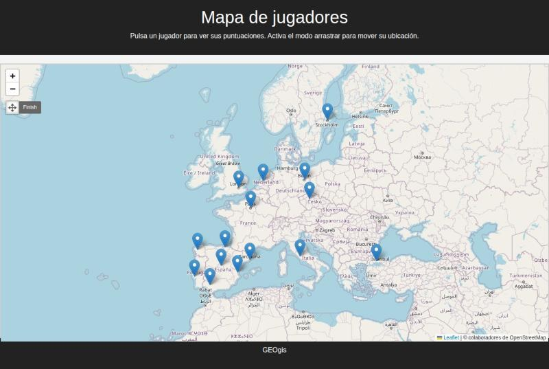
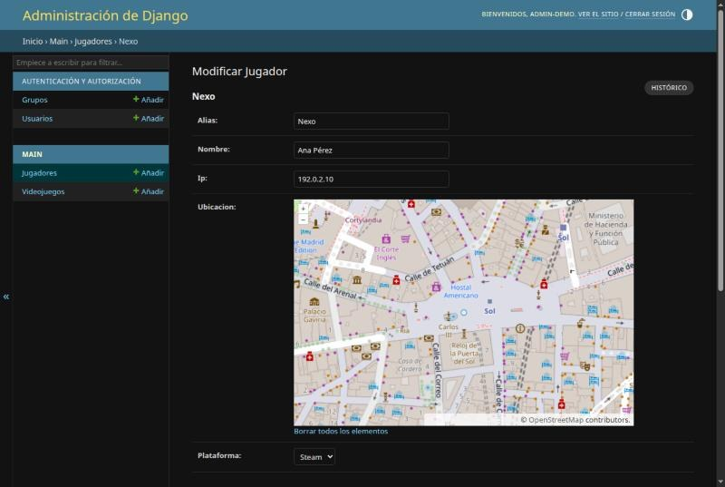

# GEOgis

Aplicación web con **GeoDjango**, **PostGIS** y **Leaflet**: muestra en un mapa a los jugadores
de videojuegos, con su plataforma y su historial de puntuaciones, y permite mover su ubicación
arrastrando el marcador.


## Qué hace

- **Mapa** con un marcador por jugador que tenga ubicación.
- **Ficha del jugador** al pulsar un marcador: alias, nombre, plataforma y puntuaciones por juego.
- **Modo arrastrar** (control de Geoman, arriba a la izquierda): al soltar un marcador, la nueva
  posición se guarda en la base de datos. Solo aparece para usuarios con permiso para editar
  jugadores, y el servidor rechaza (403) cualquier otro intento.
- **Panel de administración** de Django con mapa para editar ubicaciones, y puntuaciones por jugador.

| Ficha del jugador | Modo arrastrar (editor) |
|---|---|
|  |  |



## Arranque rápido con Docker

Solo necesitas Docker. Levanta PostgreSQL + PostGIS y la app, aplica las migraciones y carga
los datos de ejemplo:

```bash
docker compose up --build
```

Abre <http://localhost:8000/>. Para entrar al panel de administración y poder mover jugadores,
crea un usuario en otra terminal:

```bash
docker compose exec web python manage.py createsuperuser
```

## Instalación manual

### Requisitos

- Python 3.10+
- PostgreSQL con la extensión **PostGIS**
- Librerías del sistema de GeoDjango: GDAL, GEOS y PROJ
  ([guía oficial](https://docs.djangoproject.com/en/5.2/ref/contrib/gis/install/))

### Puesta en marcha

```bash
python -m venv .venv && source .venv/bin/activate
pip install -r requirements.txt

# Base de datos (una sola vez)
createdb GeoDjango
psql -d GeoDjango -c "CREATE EXTENSION postgis;"

cp .env.example .env     # rellena DB_PASSWORD y DJANGO_SECRET_KEY
export $(grep -v '^#' .env | xargs)

python manage.py migrate
python manage.py cargar_demo        # opcional: 15 jugadores y 8 juegos de ejemplo
python manage.py createsuperuser
python manage.py runserver
```

Abre <http://127.0.0.1:8000/> para el mapa y <http://127.0.0.1:8000/admin/> para añadir
jugadores, videojuegos y puntuaciones.

## Estructura

| Ruta | Contenido |
|---|---|
| `jugadores/` | Configuración del proyecto Django |
| `main/models.py` | `Jugador` (con `PointField`), `Videojuego` y `Puntuacion` |
| `main/views.py` | Vista del mapa y endpoint para guardar la ubicación |
| `main/static/js/Main.js` | Mapa, ficha del jugador y guardado al arrastrar |
| `main/management/commands/cargar_demo.py` | Datos de ejemplo (ficticios) |
| `main/tests.py` | Tests del mapa, del endpoint y de los datos de ejemplo |

## Tests

```bash
python manage.py test                                  # instalación manual
docker compose run --rm web python manage.py test      # con Docker
```

Necesitan la misma base de datos PostGIS (Django crea y borra una base de pruebas aparte).

## Licencia

MIT © Javier Cortés Vidal
